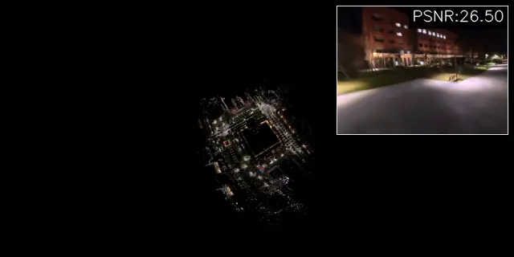
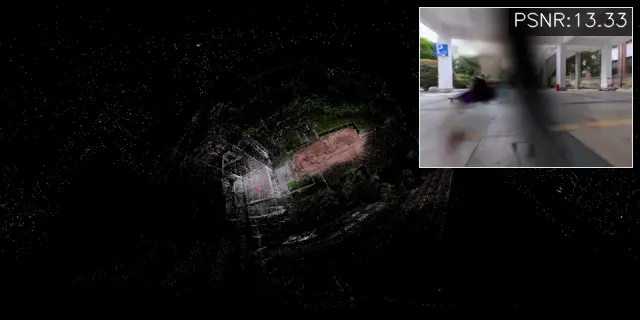
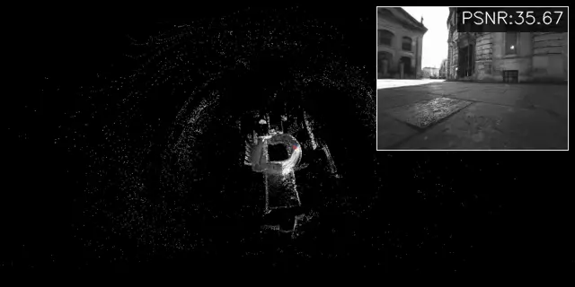
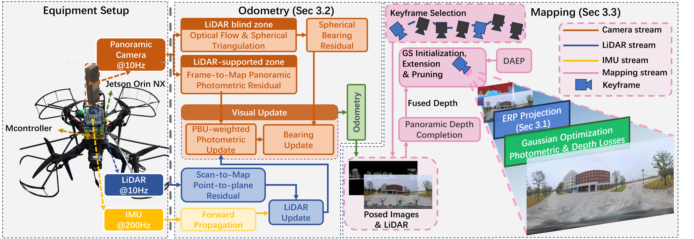

<div align="center">

# GOLD-SLAM

**Gaussian-splatting Omnidirectional LiDAR-Depth SLAM**

[](https://arxiv.org/abs/2611.32335)
[](https://insailab.org/GOLD-SLAM/)

</div>

GOLD-SLAM combines LiDAR, IMU, and panoramic images for odometry and 3D Gaussian mapping.
The frontend uses visual constraints in the LiDAR blind zone, and the mapper uses measured LiDAR depth to guide panoramic reconstruction.
Download WHOLE recordings and sensor calibration from [Hugging Face](https://huggingface.co/datasets/InSAI-Lab/WHOLE).

## Video

https://github.com/user-attachments/assets/066ef3c1-db08-4e02-b15a-578a183a9527

## Reconstruction demos

<p align="center"><strong>Oxford Spires · ChristChurch03</strong><br></p>
<p align="center"><strong>WHOLE · night_03</strong><br></p>
<p align="center"><strong>WHOLE · motion_blur_03</strong><br></p>
<p align="center"><strong>WHOLE · garage_02</strong><br></p>

<details>
<summary><strong>WHOLE · indoor_02</strong></summary>

<p align="center"></p>

</details>

<details>
<summary><strong>HILTI-Oxford · Exp21</strong></summary>

<p align="center"></p>

</details>

## System overview



## Acknowledgement

We thank the authors and contributors of [FAST-LIVO2](https://github.com/hku-mars/FAST-LIVO2), [Gaussian-LIC2](https://github.com/APRIL-ZJU/Gaussian-LIC), [DAP](https://github.com/Insta360-Research-Team/DAP), and [ODGS-SLAM](https://github.com/odgs-slam/odgs-slam) for sharing their work.

## Citation

```bibtex
@article{zhang2026goldslam,
  title   = {{GOLD-SLAM}: Gaussian-splatting Omnidirectional {LiDAR}-Depth {SLAM}},
  author  = {Weicong Zhang and Yuan Huang and Yu Zheng and Lin Chenxiao and
             Yingying Li and Lilong Fan and Liangdong Zhuang and Yufan Chen and
             Ruiping Liu and Junwei Zheng and Jiaming Zhang},
  journal = {arXiv preprint arXiv:2611.32335},
  year    = {2026},
  doi     = {10.48550/arXiv.2611.32335}
}
```
