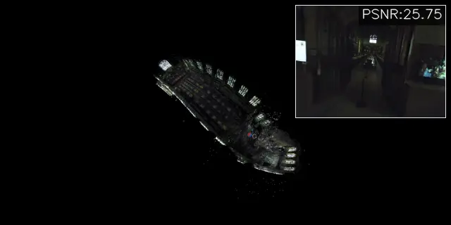
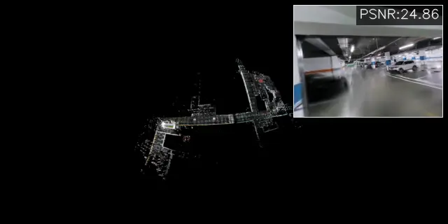
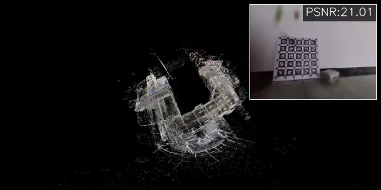

<div align="center">

# GOLD-SLAM

**Gaussian-splatting Omnidirectional LiDAR-Depth SLAM**

[Video](#video) · [Demos](#reconstruction-demos) · [Installation](#installation) · [Reproduce](#reproduce) · [Configuration](docs/configuration.md) · [Datasets](docs/datasets.md)

</div>

GOLD-SLAM combines LiDAR, IMU, and panoramic images for odometry and 3D Gaussian mapping.
The frontend uses visual constraints in the LiDAR blind zone, and the mapper uses measured LiDAR depth to guide panoramic reconstruction.
Download WHOLE recordings and sensor calibration from [Hugging Face](https://huggingface.co/datasets/InSAI-Lab/WHOLE).

## Video

https://github.com/user-attachments/assets/066ef3c1-db08-4e02-b15a-578a183a9527
## Reconstruction demos

<p align="center"><strong>Oxford Spires · ChristChurch03</strong><br></p>
<p align="center"><strong>WHOLE · night_03</strong><br></p>
<p align="center"><strong>WHOLE · motion_blur_03</strong><br></p>
<p align="center"><strong>WHOLE · garage_02</strong><br></p>

<details>
<summary><strong>WHOLE · indoor_02</strong></summary>

<p align="center"></p>

</details>

<details>
<summary><strong>HILTI-Oxford · Exp21</strong></summary>

<p align="center"></p>

</details>

## System overview


## Installation

Use a Linux x86-64 host with an NVIDIA GPU and a driver compatible with CUDA 12.8. Install Docker Engine, Docker Compose, and the NVIDIA Container Toolkit. The container uses Ubuntu 20.04 and ROS Noetic.

Run on the host.

```bash
git clone https://github.com/InSAI-Lab/GOLD-SLAM.git
cd GOLD-SLAM
cp .env.example .env
# Set GOLD_DATA_DIR in .env to mount your dataset directory at /datasets/shared.
bash docker/build.sh
docker compose up -d
docker compose exec dev bash
```

Run inside the container to prepare the pretrained models and build GOLD-SLAM.

```bash
tools/gold prepare-models
tools/gold build
```

See the [model manifest](config/models.yaml) for model versions and checksums.

## Reproduce

Run both examples inside the container from the repository root.

### WHOLE · motion_blur_03

```bash
mkdir -p data/WHOLE/motion_blur_03
curl --fail --location --retry 5 --continue-at - \
  https://huggingface.co/datasets/InSAI-Lab/WHOLE/resolve/main/motion_blur_03/sensors.bag \
  --output data/WHOLE/motion_blur_03/sensors.bag
printf '%s\n' '1067be0494f970c0a1582cbd8b8fc0e4ccb06bd42baa7b494339a17e88de88d7  data/WHOLE/motion_blur_03/sensors.bag' \
  | sha256sum --check --strict

tools/gold doctor --config config/examples/whole_motion_blur_03.yaml
tools/gold run --config config/examples/whole_motion_blur_03.yaml
```

### HILTI-Oxford 2022 · Exp14

Follow the [Exp14 download instructions](docs/datasets.md#download-exp14) for the sensor bag, calibration, and ground truth. Convert the full sequence and run GOLD-SLAM.

```bash
python scripts/prepare_hilti.py \
  --source-bag data/raw/exp14/exp14_basement_2.bag \
  --calibration-dir data/raw/exp14/calibration \
  --ground-truth data/raw/exp14/exp14_basement_2_imu.txt \
  --output-dir data_prepared/exp14
tools/gold doctor --config data_prepared/exp14/run.yaml
tools/gold run --config data_prepared/exp14/run.yaml
```

## Configuration

Use [config/defaults.yaml](config/defaults.yaml) for algorithm settings, [config/datasets](config/datasets) for sensor topics and calibration, and the run YAML for input and output paths.
The final Gaussian map and trajectory are saved as `model/gaussians.ply` and `trajectory.txt` under `output.directory`.
See [Configuration](docs/configuration.md) and [Dataset preparation](docs/datasets.md).

## License

The odometry frontend builds on [FAST-LIVO2](https://github.com/hku-mars/FAST-LIVO2), and the Gaussian mapping backend builds on [Gaussian-LIC](https://github.com/APRIL-ZJU/Gaussian-LIC).
See [LICENSE.md](LICENSE.md) for licensing terms.

## Acknowledgement

We thank the authors and contributors of [FAST-LIVO2](https://github.com/hku-mars/FAST-LIVO2), [Gaussian-LIC2](https://github.com/APRIL-ZJU/Gaussian-LIC), [DAP](https://github.com/Insta360-Research-Team/DAP), and [ODGS-SLAM](https://github.com/odgs-slam/odgs-slam) for sharing their work.
